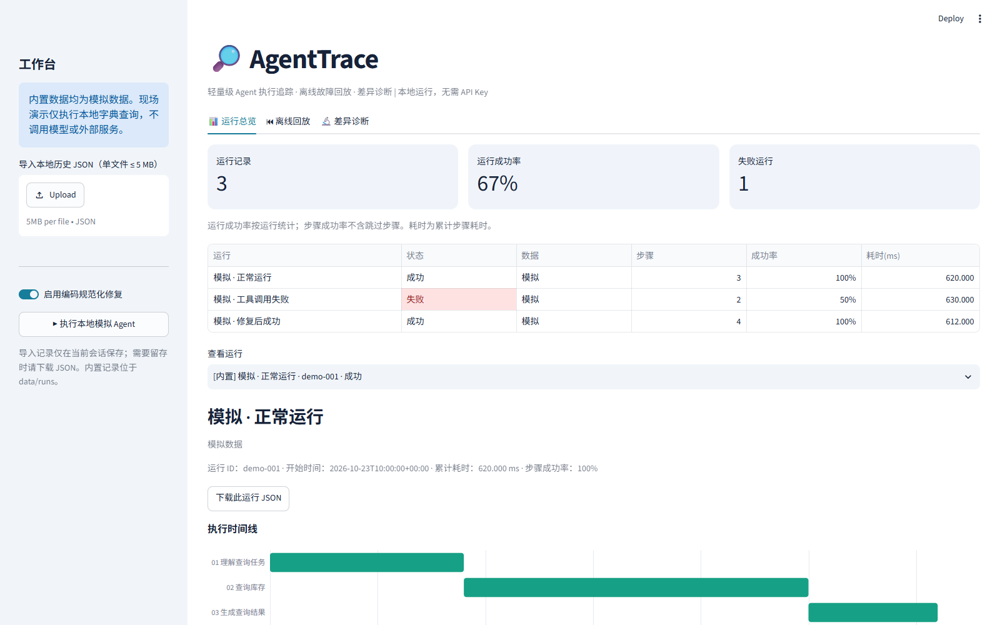

# AgentTrace

轻量级开源 AI Agent 执行追踪、离线故障回放与差异诊断工具。使用 Python、Streamlit、pandas，本地运行，无数据库、无需模型账号或付费 API。

## 文档与演示

- [项目介绍](docs/PROJECT_OVERVIEW.md)：背景、目标场景、技术实现、工程价值与边界。
- [三分钟演示流程](docs/DEMO_SCRIPT.md)：使用模拟库存查询展示失败、回放与运行对比。
- [验收记录](VALIDATION.md)、[贡献指南](CONTRIBUTING.md)、[后续规划](docs/ROADMAP.md)。



## 快速启动（Windows）

获取源码：

```powershell
git clone https://github.com/Soranaun/agenttrace.git
cd agenttrace
```

安装 Python 3.11 或以上版本并加入 PATH（本项目已在 Windows / Python 3.12.1 验证），双击 `start.bat`。脚本会在项目内创建 `.venv`、安装依赖并启动浏览器工作台。首次安装需要访问 Python 包源，安装完成后演示不需要联网。

也可以在 PowerShell 中运行：

```powershell
python -m venv .venv
.\.venv\Scripts\python.exe -m pip install -r requirements.txt
.\.venv\Scripts\python.exe -m streamlit run app.py --server.address 127.0.0.1
```

访问 <http://127.0.0.1:8501>，在终端按 `Ctrl+C` 停止。端口被占用时加 `--server.port 8502`。命令不要求激活虚拟环境，不受 PowerShell 脚本执行策略影响。

## 功能

- **执行追踪**：Run / Step 结构记录步骤 ID、名称、类型、工具、输入输出、状态、时间、耗时和异常；`TraceRecorder` 可用于接入自己的 Python Agent。
- **中文工作台**：运行列表、运行成功率、步骤成功率、累计耗时、按顺序显示的执行时间线、失败高亮和步骤详情。
- **离线回放**：读取项目 `data/runs/*.json`，或通过侧栏上传本地 JSON；使用上一步、下一步或步骤选择器查看历史输入输出。回放不会重新调用模型或工具。
- **差异诊断**：对比任意两次运行，标记新增、缺失、变化、相同步骤，展示成功率、耗时、失败步骤与错误变化，支持下载诊断报告。
- **现场演示**：侧栏可开关编码修复，执行本地模拟 Agent，立即生成新记录，支持下载 JSON 再导入。

## 三分钟演示流程

1. 打开“运行总览”，内置三组**模拟数据**：正常运行、工具调用失败、修复后成功。
2. 选择“模拟 · 工具调用失败”，展开红色步骤：输入 `a-101`，本地库存工具因编码大小写不匹配抛出 `KeyError`。
3. 打开“离线回放”，选择失败记录，逐步查看输入、输出和异常。页面明确说明这是历史回放。
4. 打开“差异诊断”，默认比较失败与修复记录。观察新增编码规范化步骤、查询输入变为 `A-101`、错误消失、步骤成功率从 50% 到 100%。
5. 在侧栏关闭修复并执行一次，打开修复再执行一次，比较现场产生的两次记录。也可下载 JSON 后上传，展示文件导入与回放。

内置数据的工具输入输出来自实际执行的本地模拟字典查询；固定日期和耗时是演示设定，**不是实际模型结果或性能基准**。现场模拟使用真实计时，但同样不调用模型。重新生成样例：

```powershell
.\.venv\Scripts\python.exe -m agenttrace.demo
```

## 接入自己的 Agent

```python
from agenttrace import TraceRecorder

trace = TraceRecorder("我的任务", simulated=False)
try:
    with trace.step("lookup", "查询库存", kind="tool",
                    tool="inventory_lookup", input={"sku": "A-101"}) as step:
        step.output = {"stock": 24}  # 替换为自己的工具调用
finally:
    trace.save("data/runs/my-run.json")
```

上下文管理器会记录并重新抛出异常，避免改变业务错误处理。保存后刷新工作台即可加载。导出输入输出应为可 JSON 序列化的数据；记录前请自行移除密码、密钥等敏感信息。

## JSON 格式与统计口径

完整可解析示例见 `data/runs/demo-001.json` 至 `demo-003.json`。

- Run：`schema_version=1`、`id`、`name`、`status`（success/failed）、`started_at`（ISO 时间）、`simulated`（布尔值）、`metadata`、`steps`。
- Step：`id`（运行内唯一）、`name`、`kind`（agent/tool/transform）、`status`（success/failed/skipped）、`started_at`、`duration_ms`（非负有限数）、`input`、`output`、`tool`、`error`。失败步骤必须提供异常信息。
- 步骤按照 `steps` 数组顺序回放。跨运行使用稳定步骤 ID 匹配；循环或重试需各自使用独立 ID。内容、工具、状态、错误和顺序变化会被标记；起始时间不参与内容差异，耗时单列比较。
- 步骤成功率 = 成功步骤 / 未跳过步骤；无已执行步骤时显示 0%。运行成功率 = 成功运行 / 当前已加载运行。
- 累计耗时为步骤耗时之和，时间线也是该累计值；不包括步骤间等待，不支持并行执行的墙钟耗时分析。
- 单个 JSON 上限 5 MB。非法文件显示错误，不阻止其他记录加载。UTF-8 及 UTF-8 BOM 文件均支持。

## 测试

```powershell
.\.venv\Scripts\python.exe -m pytest -q
```

测试覆盖模拟场景、真实本地工具失败与修复、异常记录、JSON 往返与非法文件、成功率、差异诊断，以及 Streamlit 页面渲染、回放按钮、现场演示交互。

最后验收结果、常见屏幕宽度截图和提交前演示顺序见 [VALIDATION.md](VALIDATION.md)。总览表和诊断表只显示关键列；运行 ID、起始时间在所选运行下方，完整变化字段、输入输出和异常在诊断步骤详情中，下载报告保留全部字段。时间线图例位于底部。

可选真实浏览器验收（不属于应用运行依赖）：先启动工作台，再执行：

```powershell
.\.venv\Scripts\python.exe -m pip install playwright==1.64.1
.\.venv\Scripts\python.exe scripts/browser_acceptance.py
```

验收使用本机已安装的 Chrome，无需下载浏览器；如 Chrome 位于其他目录，可设置环境变量 `AGENTTRACE_CHROME` 为浏览器可执行文件完整路径。自动检查 1366、1280、1024 像素宽度的图例边界、步骤标签、表格宽度，以及真实文件导入导出与回放。结果保存在 `artifacts/acceptance/`。

## 目录与范围

```text
app.py                 中文 Streamlit 工作台
agenttrace/models.py   数据结构与校验
agenttrace/recorder.py  记录器 API
agenttrace/demo.py      本地模拟工具与样例生成
agenttrace/storage.py  本地 JSON 加载
agenttrace/diagnostics.py 差异诊断
data/runs/             三组模拟历史记录
tests/                 pytest / Streamlit AppTest
start.bat              Windows 一键启动
```

MVP 面向单用户本地、顺序执行的 Agent。未包含在线模型接入、自动工具重试、并发追踪、鉴权和数据库。诊断为确定性记录对比，不调用大模型，不自动认定根因。上传与现场记录保存在 Streamlit 会话内，重启后需重新导入；下载 JSON 可持久保存。内置记录直接存于项目目录。不要将此本地工作台直接暴露到公网。

开源许可证：MIT，见 [LICENSE](LICENSE)。
